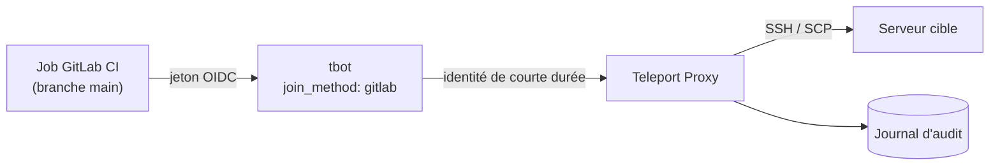

# Déploiement sans clé SSH statique : Teleport CE + GitLab CI

Exemple de pipeline qui déploie sur un serveur avec une **identité de courte durée** délivrée par Teleport, au lieu d'une clé SSH stockée dans GitLab. Le dépôt contient le pipeline (`.gitlab-ci.yml`) et la documentation associée (wiki).

> **Note** : GitHub n'exécute pas les fichiers `.gitlab-ci.yml`. Le pipeline est fourni comme exemple et se joue sur une instance GitLab.

## Objectif

- Supprimer toute clé SSH privée permanente des variables CI.
- Limiter le pipeline à ce qu'il doit faire (moindre privilège).
- Garder une trace de chaque action dans le journal d'audit de Teleport.

## Prérequis

- Teleport v18 avec un bot, un rôle `deployer` et un jeton d'enrôlement de type `gitlab`
- Une image CI contenant `tbot` et `tsh` (versions alignées avec le serveur Teleport)
- Variables CI : `TELEPORT_PROXY`, `TARGET_SERVER`
- Un serveur cible avec l'utilisateur Unix `deployer` autorisé par le rôle

## Architecture

Déroulement du job de déploiement :

1. GitLab délivre un jeton OIDC au job (audience : le domaine Teleport).
2. `tbot` présente ce jeton à Teleport (méthode d'enrôlement `gitlab`) et obtient une identité temporaire, stockée en mémoire.
3. Le job utilise cette identité pour préparer le dossier cible puis transférer les fichiers avec `tsh`.
4. Chaque connexion et chaque commande apparaissent dans le journal d'audit.

## Pipeline

| Étape | Job | Rôle |
|---|---|---|
| check | `ruff-lint` | Qualité et style Python |
| security | `gitleaks` | Détection de secrets dans le code |
| security | `sast-semgrep` | Analyse statique du code |
| deploy | `deploy-to-srv` | Déploiement via Teleport, **branche `main` uniquement** |

## Principes de sécurité

- **Identité éphémère** : aucune clé SSH privée n'est stockée dans GitLab.
- **Moindre privilège** : le job utilise un rôle dédié (`deployer`) limité au serveur cible. Le rôle à droit aux commandes chmod, chown, scp, mkdir et rsync.
- **Audit** : toutes les actions sont tracées dans le journal d'audit Teleport.
- **Déploiement conditionné** : le job de déploiement ne s'exécute que sur `main`, après les contrôles qualité et sécurité.

## Limites connues et pistes d'amélioration

| Limite | Piste |
|---|---|
| Images et outils non épinglés (`latest`, installation de Ruff sans version) | Épingler les versions (voire les digests) et construire une image d'outils versionnée |
| Le job crée le dossier cible avec un `sudo` limité à rsync chmod mkdir scp | Créer le dossier en amont avec Ansible, pour un déploiement sans `sudo` |
| Pas de séparation développement / préproduction / production | Un rôle et un serveur par environnement |
| Pas de scan des dépendances ni des images | Ajouter Trivy et la génération d'un SBOM |
| Durée de vie du jeton OIDC est fixé à une heure | Documenter les valeurs et réduire au strict nécessaire |

## Résultat vérifié

Capture d'un pipeline réussi : 

## Documentation (wiki)

- [Pipeline CI/CD](../../wiki/ci-cd) : configuration, jobs de sécurité et déploiement OIDC
- [Enrôlement des applications web](../../wiki/enrollement-page-web) : Teleport Application Access
- [Enrôlement des bases de données](../../wiki/enrollement-bdd) : accès aux bases SQL/NoSQL
- [Teleport en ligne de commande](../../wiki/teleport-en-ligne-de-commande) : aide-mémoire `tsh`, `tbot`, `tctl`

## Environnement

Teleport Community Edition v18, GitLab CI.

---

Auteur : Nicolas Personnaz
